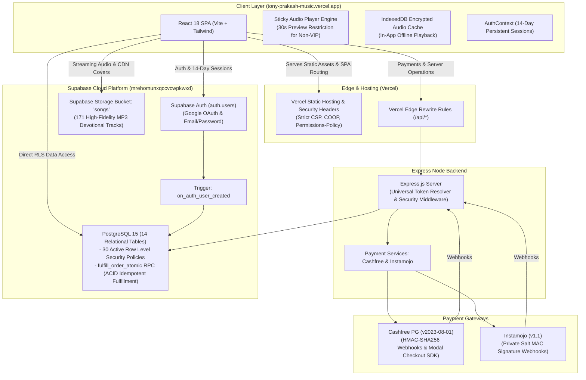

# TONY PRAKASH OFFICIAL — TONY'S MUSIC PLATFORM

[](https://react.dev)
[](https://supabase.com)
[](https://www.typescriptlang.org)
[](https://tailwindcss.com)
[](https://vercel.com)
[-brightgreen)](#automated-testing--verification-suites)

A production-grade, high-performance Telugu Christian devotional music platform, persistent audio player sanctuary, and secure payment and membership system for **Rev. Tony Prakash**—singer, lyricist, and composer.

- **Production Live URL**: [`https://tony-prakash-music.vercel.app`](https://tony-prakash-music.vercel.app)
- **Official Ministry Channel**: [`https://www.youtube.com/@TonyPrakashOfficial`](https://www.youtube.com/@TonyPrakashOfficial)

---

## 1. Creative Direction & Brand Identity: TONY'S MUSIC

The platform is designed as an Apple Music-style digital sanctuary combining spiritual reverence, editorial typography, and high-performance audio streaming.

- **Color Palette:**
  - **Midnight Black (`#090A0D`):** Deep stage horizon & infinite background.
  - **Espresso Brown (`#211A16`):** Warm atmospheric undertones & acoustic hall resonance.
  - **Antique Gold (`#C6A565` / `#DFC38A` / `#8F7138`):** Sacred halos, primary actions, and VIP membership badges.
  - **Warm Ivory (`#F4EBDD`):** Headings and high-contrast typography.
  - **Deep Charcoal (`#121318` / `#161820`):** Frosted glass surfaces and card backdrops.
- **Typography:**
  - **Headings:** *Cormorant Garamond* (Editorial serif)
  - **Body & Controls:** *Inter* (Clean, legible sans-serif)
  - **Telugu Titles & Lyrics:** *Noto Serif Telugu* (Full Unicode devotional support)

---

## 2. Core Architecture & System Topology



---

## 3. Key Features & Business Workflows

### 3.1 Music Catalog & Audio Streaming
- **171 Published Devotional Tracks**: Filterable by Worship, Devotional, Praise, and Gospel.
- **Telugu Search & Transliteration**: Real-time searching across Telugu script and English transliteration.
- **30-Second Preview Guard**: Non-members enjoy full browsing but preview songs for 30 seconds before being prompted to unlock the VIP Pass.
- **Sticky Persistent Audio Player**: Seamless playback bar across all page navigations with queue management, animated audio equalizer, and volume controls.
- **In-App Offline Audio Storage**: Spotify/Apple Music-style encrypted audio caching via IndexedDB, enabling offline listening directly within the web app without exposing raw file downloads.

### 3.2 Membership & Backing Track Pricing
- **Tony's VIP Lifetime Pass (₹299)**:
  - One-time payment. **Zero recurring renewals or subscription traps**.
  - Valid for 100 years. Unlocks unrestricted listening and in-app offline caching across all 171 tracks.
- **Single Master Backing Track (₹99)**:
  - Permanent individual track license for singers and churches.

### 3.3 Supabase Authentication & 14-Day Sessions
- **Supabase Auth as Single Source of Truth**: Unified authentication for email/password and Google OAuth.
- **14-Day Persistent Sessions**: Transparent refresh-token rotation restores sessions across browser restarts.
- **Universal Backend Token Resolver**: Validates both native Supabase Auth ES256 tokens and local JWTs, ensuring full authorization across the API.
- **Role-Based Guards**: Protected routes (`ProtectedRoute`) and Admin dashboard guards (`AdminRoute`).

### 3.4 Payment Security & Webhook Resilience
- **Cashfree PG API (v2023-08-01)**: HMAC-SHA256 signature verification over raw request buffers.
- **Instamojo API (v1.1)**: HMAC-SHA1 MAC signature verification using private salt.
- **Atomic Order Fulfillment**: Database row-locking (`FOR UPDATE`) in PostgreSQL RPC function `public.fulfill_order_atomic`.
- **Amount Tampering Defense**: Prevents client-side price tampering by verifying server-calculated amounts.
- **Duplicate & Replay Protection**: Webhook idempotency ensures repeated deliveries return success without duplicate entitlements.

---

## 4. Repository & Folder Structure

```
H:\new project/
├── backend/                        # Node.js + Express API Backend
│   ├── prisma/
│   │   └── schema.prisma           # Prisma PostgreSQL schema definition
│   ├── src/
│   │   ├── middleware/             # Security, auth, and error middleware
│   │   │   └── auth.ts             # Universal Token Resolver & requireAdmin guard
│   │   ├── routes/                 # Express REST route handlers
│   │   │   ├── admin.routes.ts     # Protected admin endpoints
│   │   │   ├── auth.routes.ts      # Authentication endpoints
│   │   │   ├── payment.routes.ts   # Cashfree & Instamojo checkout & webhooks
│   │   │   └── track.routes.ts     # Catalog management endpoints
│   │   ├── services/               # Gateway & business logic services
│   │   │   ├── cashfree.service.ts # Cashfree API & HMAC verification
│   │   │   ├── instamojo.service.ts# Instamojo API & MAC verification
│   │   │   └── fulfillment.service.ts # Order fulfillment & atomic RPC caller
│   │   ├── index.ts                # Express application entrypoint
│   │   └── supabase.ts             # Supabase client instance
│   ├── package.json
│   └── tsconfig.json
├── frontend/                       # React 18 + Vite SPA Frontend
│   ├── src/
│   │   ├── components/             # Reusable UI & Audio Player components
│   │   │   ├── AudioPlayer.tsx     # Apple Music-style persistent player
│   │   │   ├── OfflineManager.ts   # IndexedDB encrypted offline storage
│   │   │   └── TrackCard.tsx       # Track card with preview & VIP actions
│   │   ├── context/                # React context providers
│   │   │   ├── AuthContext.tsx     # 14-day persistent Supabase Auth state
│   │   │   └── AudioContext.tsx    # Audio playback engine state
│   │   ├── lib/
│   │   │   └── supabase.ts         # Supabase client with autoRefreshToken
│   │   ├── pages/                  # Route views (Lazy-loaded chunks)
│   │   │   ├── About.tsx           # Biography & vision
│   │   │   ├── AdminDashboard.tsx  # Protected administration console
│   │   │   ├── Bookings.tsx        # Ministry invitation form
│   │   │   ├── Home.tsx            # Sanctuary hero & song catalog
│   │   │   ├── Membership.tsx      # ₹299 VIP Pass & ₹99 Backing Track checkout
│   │   │   ├── PaymentReturn.tsx   # Gateway return & celebration modal
│   │   │   └── Videos.tsx          # YouTube ministry broadcast grid
│   │   ├── routes/                 # Route guards (ProtectedRoute, AdminRoute)
│   │   ├── services/               # API clients (api.ts)
│   │   ├── App.tsx                 # Route declarations & Suspense boundaries
│   │   └── index.css               # Apple Music theme styles & typography
│   ├── package.json
│   └── vite.config.ts              # Rollup manual chunks & path normalization
├── supabase/                       # Supabase Database Migrations
│   └── migrations/
│       ├── 20261106100001_auth_user_sync_trigger.sql
│       ├── 20261106100002_enable_rls_policies.sql
│       ├── 20261106100003_payment_transaction_constraints.sql
│       └── 20261106100004_atomic_fulfillment_rpc.sql
├── docs/                           # Comprehensive Engineering Documentation
│   ├── AUTHENTICATION_AND_SESSIONS.md
│   ├── DATABASE_AND_MIGRATIONS.md
│   ├── DEPLOYMENT_RUNBOOK.md
│   └── PAYMENT_INTEGRATIONS.md
├── scripts/                        # Automated Verification & Migration Scripts
│   ├── apply_migrations.cjs
│   ├── run_e2e_playwright_audit.py # Full browser Playwright automation suite
│   ├── verify_auth_persistence.cjs # Auth lifecycle verification
│   ├── verify_backend_foundation.cjs # Database & RLS foundation verification
│   ├── verify_database_rls_e2e.cjs # Database concurrency & RLS E2E suite
│   └── verify_payment_security.cjs # Payment HMAC & tampering verification
├── archive/                        # Safely preserved legacy scripts & components
│   ├── legacy_backend/
│   ├── legacy_frontend/
│   └── legacy_scripts/
├── vercel.json                     # Edge routing, security headers & strict CSP
└── README.md
```

---

## 5. Automated Testing & Verification Suites

The codebase includes an exhaustive automated test harness. All suites run against live Supabase PostgreSQL and Playwright headless Chromium:

```bash
# 1. Verify Supabase Database, RLS Policies, and Atomic RPC
node scripts/verify_backend_foundation.cjs

# 2. Verify Database Concurrency, RLS Boundaries & Race Conditions (14/14 Passed)
node scripts/verify_database_rls_e2e.cjs

# 3. Verify Supabase Auth, 14-Day Sessions & Token Rotation
node scripts/verify_auth_persistence.cjs

# 4. Verify Cashfree & Instamojo Payment Security & Webhook Idempotency
node scripts/verify_payment_security.cjs

# 5. Run Full Playwright Browser Automation E2E Audit (15/15 Passed)
python scripts/run_e2e_playwright_audit.py
```

---

## 6. Quick Start & Local Development

### Prerequisites
- **Node.js**: v18.0.0 or higher (v22.x recommended)
- **Python**: 3.10+ (for Playwright E2E testing)
- **Supabase Cloud Account** or local PostgreSQL instance

### 1. Clone & Install Dependencies
```bash
# Install backend dependencies
cd backend
npm install

# Install frontend dependencies
cd ../frontend
npm install
```

### 2. Configure Environment Variables
Copy `.env.example` templates:
```bash
cp .env.example backend/.env
cp frontend/.env.example frontend/.env
```
Update `DATABASE_URL`, `SUPABASE_URL`, and gateway keys with your development credentials.

### 3. Generate Prisma Client & Run Migrations
```bash
cd backend
npx prisma generate
node ../scripts/apply_migrations.cjs
```

### 4. Start Development Servers
In two separate terminals:
```bash
# Terminal 1: Backend API (Port 5000)
cd backend
npm run dev

# Terminal 2: Frontend SPA (Port 5173 with API Proxy)
cd frontend
npm run dev
```
Open [`http://localhost:5173`](http://localhost:5173) in your browser.

---

## 7. Production Build & Deployment

### Build Commands
```bash
# Frontend production build (Typecheck & Vite manual chunks)
npm --prefix frontend run build

# Backend production build (Prisma client & TypeScript compiler)
npm --prefix backend run build
```

### Vercel Deployment
Deploying to Vercel is fully automated via `vercel.json`:
- Static SPA outputs from `frontend/dist` are deployed to global Edge CDN.
- Security headers (Strict CSP, Permissions-Policy, X-Frame-Options) are applied at the edge.
- Client-side navigation (`/((?!api/.*).*)`) rewrites to `/index.html` to prevent 404s on browser refresh.

For complete deployment runbooks, see [`docs/DEPLOYMENT_RUNBOOK.md`](docs/DEPLOYMENT_RUNBOOK.md).

---

## 8. License & Ministry Rights

© 2026 **Rev. Tony Prakash**. All music compositions, devotional lyrics, album artwork, and audio recordings are the exclusive property of Rev. Tony Prakash and Tony Prakash Music Ministries. Platform software engineered for sacred musical excellence.
