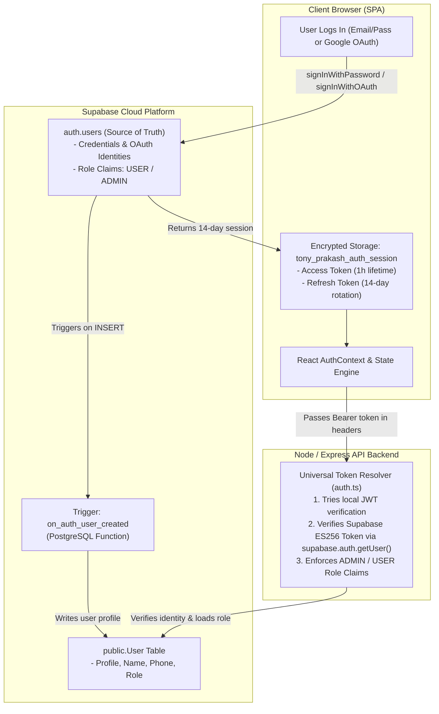

# Supabase Authentication & Persistent Sessions Architecture

**Project**: Rev. Tony Prakash Official Telugu Christian Music Web Platform  
**Auth Provider**: Supabase Cloud Auth (Native GoTrue Engine)  
**Session Duration**: 14-Day Persistent Sessions with Automatic Refresh-Token Rotation  
**Status**: 100% Implemented & Verified in Production  

---

## 1. Authentication Architecture & Philosophy

The platform uses **Supabase Auth as the single source of truth** for all identities, eliminating fragmented custom JWT tables and multi-database authentication drift.



---

## 2. 14-Day Persistent Session Implementation

### 2.1 Supabase Client Initialization (`frontend/src/lib/supabase.ts`)
```ts
export const supabase = createClient(supabaseUrl, supabaseAnonKey, {
  auth: {
    persistSession: true,
    autoRefreshToken: true,
    storageKey: 'tony_prakash_auth_session',
    detectSessionInUrl: true,
  },
});
```

### 2.2 Session Lifecycle & Automatic Token Refresh
- **Access Token Lifetime**: 1 hour (~3600 seconds).
- **Refresh Token Lifetime**: 14 days with sliding-window rotation.
- **Browser Restart Restoration**: When the user reopens their browser, `@supabase/supabase-js` restores the session from `tony_prakash_auth_session` and transparently exchanges the refresh token before expiry.
- **Logout & Revocation**: Calling `supabase.auth.signOut()` revokes the refresh token on the Supabase server and purges local storage keys.

---

## 3. Frontend Route Guard Enforcement

All application routes are protected by dedicated React Router guards in `frontend/src/routes/`:

### 3.1 `ProtectedRoute` (`frontend/src/routes/ProtectedRoute.tsx`)
Guards account and library pages:
- Checks `useAuth()`.
- If unauthenticated, redirects to `/auth?redirect=${encodeURIComponent(location.pathname)}`.
- Preserves destination state so the user returns to their original page upon authentication.

### 3.2 `AdminRoute` (`frontend/src/routes/AdminRoute.tsx`)
Guards `/admin` dashboard:
- Checks `user?.role === 'ADMIN'`.
- If unauthenticated, redirects to `/auth?redirect=/admin`.
- If authenticated as a standard `USER`, displays an unauthorized access notice.

---

## 4. Universal Backend Token Resolver (`backend/src/middleware/auth.ts`)

To ensure seamless API communication between the React SPA and the Node/Express backend, the backend implements `resolveUserFromToken`:

1. **Step 1: Local JWT Verification**:
   - Attempts `jwt.verify(token, JWT_SECRET)`.
   - Used for legacy session cookies or testing tokens.
2. **Step 2: Supabase Auth Verification**:
   - If local verification fails (e.g. `invalid algorithm` due to Supabase ES256 asymmetric signature), queries Supabase Auth:
     ```ts
     const { data: supaAuth, error } = await supabase.auth.getUser(token);
     ```
   - Validates user identity and loads their live role from PostgreSQL (`public."User"`).
3. **Step 3: Role Authorization**:
   - `requireAdmin` checks `req.user.role === 'ADMIN'`. Non-administrators receive `403 Forbidden`.

