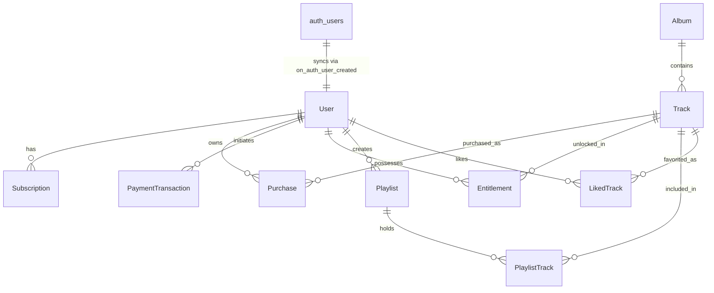

# Database Schema, Migrations & Row Level Security (RLS)

**Project**: Rev. Tony Prakash Official Telugu Christian Music Web Platform  
**Database**: Supabase Cloud PostgreSQL 15  
**ORM / Data Layer**: Prisma ORM (v5.22.0) + Native Supabase Client (`@supabase/supabase-js`)  
**Status**: 100% Implemented & Verified in Production  

---

## 1. Relational Database Architecture

The database architecture is designed with strict relational integrity, foreign key cascades, and atomic ACID transaction guarantees across catalog, user management, and payment fulfillment.

### Core Tables & Models



### Table Definitions & Purpose

1. **`User`** (`public."User"`):
   - Mirrored from Supabase `auth.users` via database trigger.
   - Fields: `id` (UUID), `email` (TEXT UNIQUE), `name` (TEXT), `phone` (TEXT), `role` (TEXT default `'USER'`), `avatar` (TEXT), `createdAt`, `updatedAt`.
2. **`Track`** (`public."Track"`):
   - Stores 171 high-fidelity devotional songs.
   - Fields: `id`, `slug` (UNIQUE), `titleTelugu`, `titleEnglish`, `albumId` (FK), `audioUrl`, `durationSeconds`, `lyricsTelugu`, `composer`, `singer`, `isPopular`, `isFeatured`, `subscriberOnly`.
3. **`Album`** (`public."Album"`):
   - Stores official music albums (*నీతో / Neetho*, *దేవ సన్నిధి / Deva Sannidhi*, *కీర్తనల యాత్ర / A Journey of Praise*).
   - Fields: `id`, `slug` (UNIQUE), `titleTelugu`, `titleEnglish`, `coverImage`, `releaseYear`.
4. **`Video`** (`public."Video"`):
   - Stores 30 curated YouTube ministry video broadcasts and sermon clips.
   - Fields: `id`, `youtubeId` (UNIQUE), `titleTelugu`, `titleEnglish`, `thumbnailUrl`, `category`, `publishedAt`.
5. **`Subscription`** (`public."Subscription"`):
   - Tracks ₹299 One-Time VIP Lifetime Pass entitlements.
   - Fields: `id`, `userId` (FK), `planName` (default `"Tony's VIP Pass"`), `status` (`ACTIVE`), `amountPaise` (29900), `currentPeriodStart`, `currentPeriodEnd` (set to 100 years for lifetime access), `gateway`, `gatewayOrderId`, `gatewayPaymentId`.
6. **`Purchase`** (`public."Purchase"`):
   - Tracks individual master backing track purchases (₹99).
   - Fields: `id`, `userId` (FK), `trackId` (FK), `amountPaise` (9900), `status` (`SUCCESS`), `gateway`, `gatewayOrderId`, `gatewayPaymentId`.
7. **`PaymentTransaction`** (`public."PaymentTransaction"`):
   - Immutable financial transaction ledger.
   - Fields: `id`, `orderId` (UNIQUE), `gateway` (`CASHFREE` / `INSTAMOJO`), `gatewayOrderId`, `gatewayPaymentId`, `userId` (FK), `itemType` (`VIP_PASS` / `TRACK`), `trackId` (FK), `amountPaise`, `currency` (`INR`), `status` (`PENDING` / `SUCCESS` / `FAILED` / `CANCELLED`), `customerName`, `customerEmail`, `customerPhone`, `paymentMethod`, `errorMessage`.
8. **`Entitlement`** (`public."Entitlement"`):
   - Fast authorization lookup mapping users to unlocked tracks.
   - Fields: `id`, `userId` (FK), `trackId` (FK), `entitlementType` (`PURCHASE` / `SUBSCRIPTION`), `validUntil`.
   - Unique Constraint: `@@unique([userId, trackId, entitlementType])`.
9. **`Playlist` & `PlaylistTrack`**:
   - User-curated devotional song collections.
10. **`LikedTrack`**:
    - User favorites with fast unique lookup `@@unique([userId, trackId])`.
11. **`SiteSetting`**:
    - Centralized runtime settings (e.g. `PAYMENTS_PAUSED`, emergency announcements).

---

## 2. Versioned Database Migrations

All schema changes and security configurations are maintained in `supabase/migrations/`:

| Migration File | Description | Verification Status |
| :--- | :--- | :---: |
| `20261106100001_auth_user_sync_trigger.sql` | PostgreSQL trigger `on_auth_user_created` automatically syncing `auth.users` to `public.User`. | ✅ Active |
| `20261106100002_enable_rls_policies.sql` | Enabled RLS on all tables and created 30 role-based access policies. | ✅ Active |
| `20261106100003_payment_transaction_constraints.sql` | Enforced unique orderId, valid status enums, foreign keys, and indexes. | ✅ Active |
| `20261106100004_atomic_fulfillment_rpc.sql` | Created `public.fulfill_order_atomic` function with row-level locks and idempotency. | ✅ Active |

---

## 3. Row Level Security (RLS) Policy Architecture

Supabase PostgreSQL employs **30 granular Row Level Security policies** to guarantee zero data leakage:

### 3.1 Public Read-Only Access
- **`Track` (`track_public_read`)**: Anyone (`public`) can read published song metadata and audio preview URLs.
- **`Album` (`album_public_read`)**: Anyone can view album release details.
- **`Video` (`video_public_read`)**: Anyone can view video lists.
- **`SiteSetting` (`site_setting_public_read`)**: Anyone can read non-sensitive site settings.

### 3.2 User Data Isolation
- **`User` (`user_select_self`, `user_update_self`)**: Authenticated users can only read and update their own profile record (`id = auth.uid()`).
- **`Subscription` (`subscription_select_self`)**: Users can only view their own active subscriptions. Direct insertion or modification is blocked.
- **`Purchase` (`purchase_select_self`)**: Users can only view their own purchases.
- **`Entitlement` (`entitlement_select_self`)**: Users can only inspect their own track entitlements.
- **`PaymentTransaction` (`payment_tx_select_self`)**: Users can only view their own payment transactions. Direct insertion or modification is blocked by RLS to prevent status forgery.
- **`LikedTrack` & `Playlist`**: Users can `SELECT`, `INSERT`, `UPDATE`, and `DELETE` only their own playlists and favorites.

### 3.3 Administrator Access
- Custom PostgreSQL function `public.is_admin()` checks whether `auth.jwt() ->> 'role' = 'ADMIN'` or the user profile has `role = 'ADMIN'`.
- All tables have `*_admin_all` policies granting full administrative privileges to verified administrators.

---

## 4. Atomic Order Fulfillment RPC (`fulfill_order_atomic`)

To prevent duplicate activations, race conditions, and currency tampering during webhook processing, fulfillment is executed entirely inside an ACID transaction using PostgreSQL row locking:

```sql
SELECT public.fulfill_order_atomic(
  p_order_id TEXT,
  p_gateway TEXT,
  p_gateway_order_id TEXT,
  p_gateway_payment_id TEXT,
  p_payment_method TEXT DEFAULT NULL
);
```

### Execution Flow:
1. **Row Lock (`FOR UPDATE`)**: Atomically locks the target transaction row in `public."PaymentTransaction"`.
2. **Idempotency Guard**: If `status = 'SUCCESS'`, returns `alreadyFulfilled: true` immediately without updating records or firing duplicate activations.
3. **Ledger Update**: Sets `status = 'SUCCESS'`, records gateway transaction identifiers, and updates timestamps.
4. **Subscription Activation**: For `VIP_PASS`, creates or renews the `Subscription` with `planName = "Tony's VIP Pass"` and valid until 100 years into the future.
5. **Entitlement Generation**: Automatically grants full track access across the catalogue.
