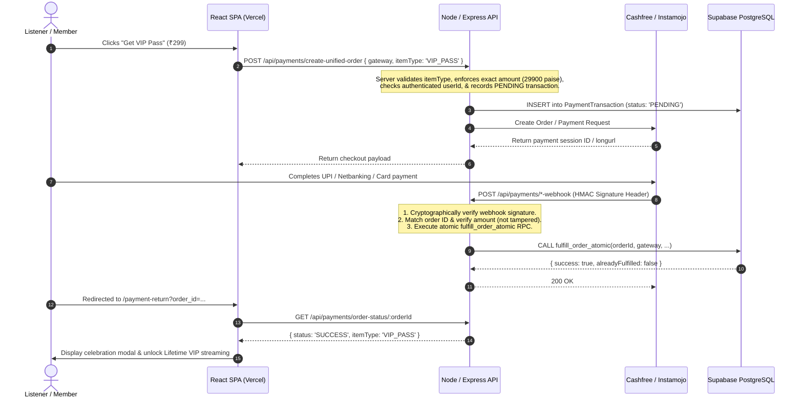

# Cashfree & Instamojo Payment Integration & Webhook Security

**Project**: Rev. Tony Prakash Official Telugu Christian Music Web Platform  
**Gateways**: Cashfree PG (v2023-08-01) & Instamojo (v1.1)  
**Currencies & Pricing**: INR (₹299 One-Time VIP Lifetime Pass, ₹99 Single Backing Track)  
**Security Architecture**: HMAC Cryptographic Validation + Atomic RPC Fulfillment  

---

## 1. Executive Payment Flow Overview

The platform supports two official payment gateways without recurring subscription renewals or surprise fees:



---

## 2. Cashfree Payment Gateway Integration

### 2.1 Order Creation
- **Endpoint**: `POST /api/payments/create-unified-order`
- **Cashfree API Endpoint**:
  - Sandbox: `https://sandbox.cashfree.com/pg/orders`
  - Production: `https://api.cashfree.com/pg/orders`
- **Headers**:
  - `x-client-id`: Cashfree App ID
  - `x-client-secret`: Cashfree Secret Key
  - `x-api-version`: `2023-08-01`
- **Payload Generated**:
  ```json
  {
    "order_id": "tp_vip_pass_1793354996169_7e0801f9",
    "order_amount": 299.00,
    "order_currency": "INR",
    "customer_details": {
      "customer_id": "dc4b46a5-9541-4908-9c29-029c40887210",
      "customer_email": "listener@example.com",
      "customer_phone": "9876543210"
    },
    "order_meta": {
      "return_url": "https://tony-prakash-music.vercel.app/payment-return?order_id={order_id}",
      "notify_url": "https://tony-prakash-music.vercel.app/api/payments/cashfree-webhook"
    }
  }
  ```

### 2.2 Webhook Signature Verification (`cashfree.service.ts`)
Cashfree signs every webhook using **HMAC-SHA256**. The raw request body is captured by Express before JSON parsing:
```ts
const signaturePayload = `${timestamp}${rawBody}`;
const expectedSignature = crypto
  .createHmac('sha256', CASHFREE_SECRET_KEY)
  .update(signaturePayload)
  .digest('base64');

const isValid = crypto.timingSafeEqual(
  Buffer.from(signature, 'utf8'),
  Buffer.from(expectedSignature, 'utf8')
);
```

---

## 3. Instamojo Payment Integration

### 3.1 Payment Request Creation
- **Endpoint**: `POST /api/payments/create-unified-order` with `gateway: 'INSTAMOJO'`
- **Instamojo API Endpoint**:
  - Sandbox: `https://test.instamojo.com/api/1.1/payment-requests/`
  - Production: `https://www.instamojo.com/api/1.1/payment-requests/`
- **Headers**:
  - `X-Api-Key`: Instamojo API Key
  - `X-Auth-Token`: Instamojo Auth Token
- **Parameters**:
  - `amount`: `'299.00'` (strictly formatted to 2 decimals)
  - `purpose`: `"Tony's VIP Lifetime Pass"`
  - `redirect_url`: `https://tony-prakash-music.vercel.app/payment-return`
  - `webhook`: `https://tony-prakash-music.vercel.app/api/payments/instamojo-webhook`

### 3.2 MAC Signature Verification (`instamojo.service.ts`)
Instamojo computes an HMAC-SHA1 signature over all POST fields (excluding `mac`) sorted alphabetically and joined with `|`, keyed with the private salt:
```ts
const sortedKeys = Object.keys(payload)
  .filter((key) => key.toLowerCase() !== 'mac')
  .sort((a, b) => a.localeCompare(b, undefined, { sensitivity: 'base' }));

const message = sortedKeys.map((k) => payload[k]).join('|');
const calculatedMac = crypto
  .createHmac('sha1', INSTAMOJO_SALT)
  .update(message)
  .digest('hex');

const isValid = calculatedMac.toLowerCase() === receivedMac.toLowerCase();
```

---

## 4. Tamper Prevention & Security Defenses

1. **Server-Calculated Amounts**:
   - The frontend never dictates the price. The server maps `VIP_PASS` to strictly 29900 paise (₹299) and `TRACK` to 9900 paise (₹99).
   - Any transaction reporting an unexpected amount or currency is marked `FAILED` with reason `Amount tampering detected`.
2. **Duplicate & Replay Protection**:
   - Webhook event IDs are checked against `public.WebhookEvent`.
   - Repeated webhook deliveries are handled idempotently via PostgreSQL row locking (`FOR UPDATE`) in `fulfill_order_atomic`.
3. **User Authentication Binding**:
   - The user ID is attached to the transaction ledger at creation time.
   - Payments cannot be hijacked or transferred to different accounts.

